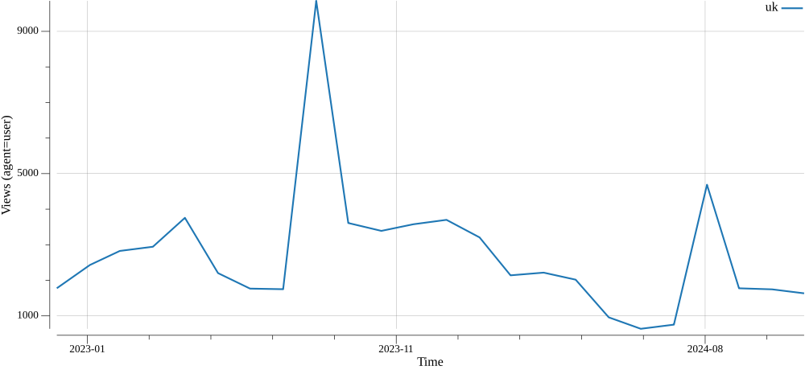

# Wikipedia Interest Analyst — Agent Skill

Навичка для AI-агента, яка допомагає командам B2C-продуктів вирішувати, **які
теми розвивати** та **якими мовами запускатися**, спираючись на статистику
переглядів статей Wikipedia (Wikimedia Pageviews).

Навичка й увесь код: [`.claude/skills/wiki-interest-analyst/`](.claude/skills/wiki-interest-analyst/)
(формат [Agent Skills](https://docs.claude.com/en/docs/agents-and-tools/agent-skills):
`SKILL.md` + власний Go-код). Детальний опис — у README всередині директорії навички.

## Проблема і підхід

Інтерес до статті ще не означає готовність платити, але добре показує **напрям
для перевірки** і **як він змінюється в часі**. Головна пастка — прийняти шум за
тренд. Тому навичка не просто рахує «зростання %», а оцінює **довіру до
висновку**: чи тренд статистично значущий, чи достатня база переглядів, чи ряд
повний, чи це не разовий сплеск (новинна подія). Висновок формулюється
консервативно: `growing`/`declining` лише за значущого нахилу, інакше `stable`.

Ключове рішення для вимоги «ефективно на дешевій моделі» (Haiku 4.5): **уся
змістовна робота — у коді**. Агент лише обирає підкоманду CLI й читає компактний
JSON. Це прибирає ризик, що слабка модель сама писатиме аналітику чи вигадає
числа. Команда `brief` виконує весь конвеєр (resolve → fetch → analyze → report)
за один виклик.

## Швидкий старт

```bash
cd .claude/skills/wiki-interest-analyst
go build -o bin/wiki ./cmd/wiki
./bin/wiki brief --theme "астрономія" --langs uk --start 2023-01-01 --end 2024-12-31 --out report.pdf
go test ./...
```

## Приклади (три сценарії з умови)

Три готові звіти закомічено в
[`examples/`](.claude/skills/wiki-interest-analyst/examples/) як демонстрація
(інші, ад-хок прогони, ігноруються git). Ось графік зі сценарію 2:



Відтворити всі три:

```bash
# 1) Інтервальне голодування: чеська vs польська.
#    Демонструє чесність: у польській немає інтервікі-статті → pl як `unresolved`.
./bin/wiki brief --theme "інтервальне голодування" --langs cs,pl \
  --start 2022-01-01 --end 2024-12-31 --lang uk --out examples/ex1_fasting.pdf

# 2) Чи зростає інтерес до астрономії українською.
#    Демонструє розділення «якість даних» і «довіра до тренду»: база велика,
#    але нахил незначущий → `stable`, а не «падіння».
./bin/wiki brief --theme "астрономія" --langs uk \
  --start 2023-01-01 --end 2024-12-31 --lang uk --out examples/ex2_astronomy.pdf

# 3) Інтерес до англійської у різних мовних розділах.
#    Демонструє порівняння кількох мов із ранжуванням.
./bin/wiki brief --theme "англійська мова" --langs uk,pl,cs,de \
  --start 2022-01-01 --end 2024-12-31 --lang uk --out examples/ex3_english.pdf
```

## Ручне тестування

```bash
cd .claude/skills/wiki-interest-analyst
go build -o bin/wiki ./cmd/wiki
go test ./...                     # 1) юніт-тести (без мережі)

# 2) резолвинг: перевір назви статей по мовах і що не резолвиться
./bin/wiki resolve --theme "астрономія" --langs uk,pl,cs,de

# 3) один ряд: перевір points/total і облік пропусків (missing_buckets)
./bin/wiki fetch --project uk.wikipedia --article "Астрономія" \
  --start 2023-01-01 --end 2024-12-31

# 4) аналіз + збереження повних даних для звіту
./bin/wiki analyze --theme "йога" --langs uk,pl --start 2022-01-01 --end 2024-12-31 --json a.json
./bin/wiki report --input a.json --out r.pdf --lang uk   # рендер без повторного фетчу

# 5) наскрізний golden path (див. приклади вище), відкрий PDF і переконайся:
#    кирилиця читається, є графік, висновки й блок обмежень.

# 6) граничні випадки:
./bin/wiki fetch --project uk.wikipedia --article X --start 2022-13-01 --end 2022-12-31  # помилка дати
./bin/wiki brief --theme "неіснуючазовсімтема12345" --langs uk --start 2023-01-01 --end 2023-12-31 --out /tmp/x.pdf  # чесна помилка
./bin/wiki fetch --project uk.wikipedia --article "Астрономія" --start 2024-01-01 --end 2024-03-31 --granularity daily  # денна деталізація

# 7) кеш: повтори будь-який виклик — другий раз має бути помітно швидшим
#    (--no-cache вимикає кеш).
```

Наскрізний сценарій перевірявся на **Claude Haiku 4.5** (див. розділ нижче).

## Як тут використано AI-інструменти і як перевірявся результат

Розробка велася з AI-асистентом. Щоб не покладатися на нього наосліп, результат
перевірявся так:

- **Контракти API звірено з першоджерелом**, а не з пам'яті моделі: формат
  ендпоінта Pageviews, дозволені значення `access`/`agent`, глибина даних із
  2015-07 та обов'язковий `User-Agent` (без нього 403/429).
- **Юніт-тести на синтетичних даних** фіксують саме ту поведінку, якої я хочу
  (чистий ramp → значущий тренд і висока довіра; шум → `stable`; сплеск →
  `spike_driven` і низька довіра; мала база → не висока довіра). Це ловить
  правдоподібні, але хибні висновки моделі про статистику.
- **Наскрізна перевірка на реальних даних.** Наприклад, астрономія (uk) має
  велику базу, але тренд незначущий — навичка правильно каже `stable`/висока
  довіра, а не «падіння -27%». Польської статті про інтервальне голодування
  немає — навичка чесно повертає `unresolved`, а не підставляє іншу тему.
- **Візуальна перевірка PDF** (рендер кирилиці, легенда, блок обмежень).
- **Сценарій на дешевій моделі** — прогнано на Claude Haiku 4.5 (нижче).

### Перевірка на Claude Haiku 4.5

Навичку перевірено на швидкій недорогій моделі, як вимагає завдання. Умови:
навичка підключена в Claude Code, основна модель — **Haiku 4.5**; їй давалися
запити природною мовою з умови (порівняння мов; чи зростає інтерес і наскільки
довіряти; який мовний ринок досліджувати наступним). Приклади у `examples/`
згенеровані в цьому режимі.

## Ітеративний розвиток (як розвивати далі)

Після базових запитів навичку можна нарощувати так:

1. **Більше даних за виклик.** Паралельний батч-фетч багатьох статей/мов;
   `top`-ендпоінти Pageviews для автопідбору статей-кандидатів у темі.
2. **Глибша статистика.** Сезонна декомпозиція (STL) і детренд, зміна режиму
   (change-point detection), довірчі інтервали на прогноз, згладжування.
3. **Нормалізація для чесного порівняння мов** — ділити на розмір мовного
   розділу / активних читачів, щоб порівнювати частку уваги, а не абсолюти.
4. **Крос-валідація сигналу** іншими джерелами (Google Trends, app-store
   пошуки), щоб відділяти стійкий інтерес від новинних сплесків.
5. **Проксі готовності платити** — зв'язок теми з монетизовними сигналами
   (ключові слова реклами, наявні платні продукти) як окремий шар.
6. **Пам'ять досліджень** — зберігати запити/висновки, щоб повторні й пов'язані
   питання спиралися на попередній контекст, а звіти були відтворюваними.
7. **Масштаб** — черга завдань і персистентний кеш (напр. SQLite) для великих
   обсягів; ліміти запитів Wikimedia враховані через кеш і ретраї.
